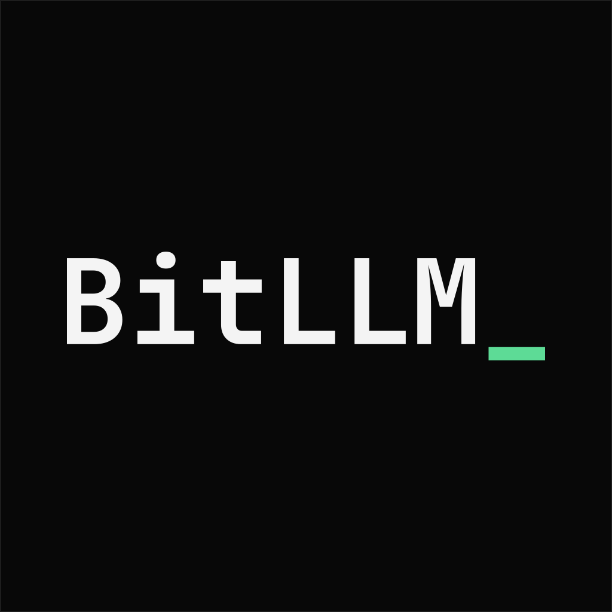

# BitLLM brand

The mark is the wordmark: `BitLLM_` set in JetBrains Mono Bold, white on black, with the
underscore in green. Nothing else. The underscore is the terminal cursor.

## Files

| file | use |
|---|---|
| `logo.svg` | primary square mark, 1024x1024, outlined paths |
| `logo.png` | primary PNG export, 1024x1024 |
| `logo-512.png` | 512x512 PNG |
| `logo-128.png` | 128x128 PNG |
| `fonts/` | the interface fonts: see [fonts/README.md](fonts/README.md) |

The SVG is outlined, so it renders the same without the font installed.

## Wordmark

Set `BitLLM_` in JetBrains Mono Bold. The casing is fixed: capital B, lowercase it, capital LLM,
then the underscore. The underscore is green (`#5ddb96`). In motion it may blink like a terminal
cursor. Do not remove it, replace it with a period, or set the wordmark in a proportional font.

## Color

| token | value | use |
|---|---|---|
| tile | `#080808` | mark background |
| ink | `#f4f4f4` | the wordmark |
| green | `#5ddb96` | the underscore, and only the underscore in the mark |
| line | `#1e1e1e` | tile edge |
| sub | `#9b9b9b` | secondary text |

Green is the highlight color, not the background. The dashboard is black and white, with green
used only for the wordmark cursor, the online dot, the selected model, and a successful test.

## Type

JetBrains Mono for the wordmark, headings, labels and code. Arimo for prose. Both are OFL.

The site and the dashboard ship the same files from `fonts/`, so every OS shows the same letters.
System fonts are only a fallback, for characters the files do not cover. The logo is outlined from
JetBrains Mono Bold so the file is self-contained.

## Usage

- Keep clear space equal to the width of the underscore on every side.
- Use at least 96 px for the square when the wordmark should read.
- Do not recolor the white type or the green underscore.
- Do not add a grid, gradient, glow, outline, or extra shapes.
- Do not rotate or crop the wordmark.
- The black tile is part of the mark. Place it on light or dark surfaces as is.
- In text, write `BitLLM_` in a monospace face. The underscore may sit in green.
